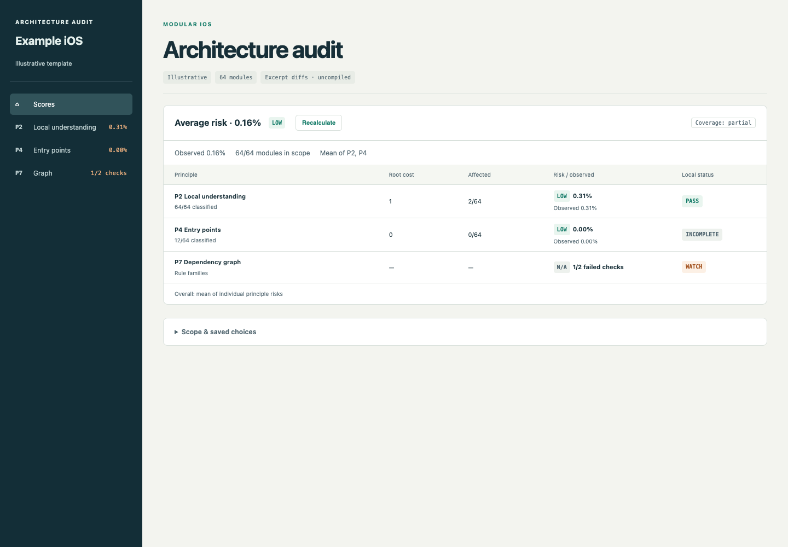

# Modular iOS Audit

An architecture audit skill for **Claude Code**, **Codex**, and agents supporting the [Agent Skills standard](https://agentskills.io/specification).

Eight principles. Evidence-backed findings. A compact, interactive HTML report.



## Install

### Skills CLI (recommended)

Use [Vercel's Skills CLI](https://github.com/vercel-labs/skills) with Node.js **22.20+**. Run from the project where you want the skill:

```sh
npx skills add SzymonMrozek/modular-ios-audit
```

Choose your agents interactively, or target Claude Code and Codex together:

```sh
npx skills add SzymonMrozek/modular-ios-audit --agent claude-code codex
```

Add `--global` to install across projects. Invoke `/modular-ios-audit` in Claude Code or `$modular-ios-audit` in Codex. The installer includes the bundled scripts, references and report assets; install Python dependencies separately as described below.

### Manual installation

Install the **whole repository**, including `scripts/`, `references/`, and `assets/`.

#### Codex

```sh
git clone https://github.com/SzymonMrozek/modular-ios-audit.git ~/.agents/skills/modular-ios-audit
```

Invoke `$modular-ios-audit`, or ask for a modular architecture audit. Start a new agent session after installing if it is not discovered immediately.

#### Claude Code

```sh
git clone https://github.com/SzymonMrozek/modular-ios-audit.git ~/.claude/skills/modular-ios-audit
```

Invoke `/modular-ios-audit`.

For a shared installation, install once for Codex, then link Claude Code to that folder:

```sh
mkdir -p ~/.claude/skills
ln -s ~/.agents/skills/modular-ios-audit ~/.claude/skills/modular-ios-audit
```

These commands intentionally do not replace an existing installation. For an existing clone, update it with `git -C <installation-path> pull --ff-only` after preserving any local edits.

For repository-scoped use, place the skill under `.agents/skills/modular-ios-audit/` for Codex or `.claude/skills/modular-ios-audit/` for Claude Code. The same skill files serve both agents; `agents/openai.yaml` is optional Codex display metadata.

## Use

```text
Audit the latest local main against all eight principles.
Ignore the modules I explicitly list and keep the audit read-only.
```

```text
Audit P2 and P3 only. Use the current working tree, including local changes.
```

The agent runs the structure scan, checks its module discovery against the actual build system, freezes the module inventory and import graph, and delegates one independent evaluator per selected principle; each must confirm or dismiss the structural candidates the scan routes to it. No particular DI library, app architecture, project generator, build runner, MCP server, or review tool is required. If the host cannot delegate, the skill discloses that limitation and offers a labelled single-agent alternative.

The audit does not change application code. It distinguishes inspected facts, structural risks, suggestions, unknown checks and unverified proposed code.

### Interpreting the results

Treat the audit as input to engineering judgment, not a final verdict. Risk scores try to highlight the potential importance and reach of architectural problems. They are not an objective grade for your codebase; the engineer makes the actual assessment.

The skill may flag something you consider unimportant for your project, and that is completely fine. Mark a finding **Invalid for this repo** if it does not apply to your context, or **Acceptable for this project** if it describes a real issue you consider a reasonable tradeoff. You decide which findings deserve action.

LLM-based audits can vary between runs. A fresh audit may uncover another high-scoring problem even after you fixed the previous findings. Two or three passes, with consistent fixes between them, can often bring the reported risk down to low. That is a practical expectation, not a guarantee: use repeated audits to improve the architecture, and keep the score in perspective.

## Report

- **Risk %** per principle = severity-weighted share of modules that own or import its open defects; the headline is the worst principle ("Risk 33.8% · worst principle P1") with a **LOW / MEDIUM / HIGH** band and the modules involved across all principles as a count; no overall pass/fail gate.
- A deterministic structure scan first. It routes monolithic targets, contamination hubs and mixed concerns to P1, parallel abstractions to P5 and tangled graphs to P7; every candidate is confirmed or dismissed before a score is shown.
- Git change history backs P1 severity: over the year before the audited commit, how often each module changed, how many of those changes were fixes, and how often they also edited its importers. A medium P1 finding on a module with broad co-change with its importers, or on a monolith most changes go through, must be high unless its evaluator shows that history comes from something else.
- Top problems ranked by risk, each with its defect modules and involved modules.
- Individual principle scores, consequence weighting, coverage and check evidence.
- Compact narrow low/medium findings (≤2 modules, below 2%), readable principle pages and direct issue/fix/evidence links.
- Swift and other iOS language syntax highlighting in git-style diffs.
- Reason-free **Resolved / Invalid for this repo / Acceptable for this project** checkboxes.
- Immediate recalculation, local persistence, export/import/reset and module exclusions.
- Self-contained HTML, local file URL and default external-browser opening.

These scores are an explicit review policy, not an industry benchmark or a probability of failure. See [scoring policy](references/scoring.md). A public primitive or missing wrapper alone does not establish a defect.

## Requirements

- A coding agent with repository read access and shell tools.
- Python **3.10+**. Scoring and report preparation use the standard library.
- [Pygments](https://pygments.org/) for generating highlighted diffs. Use an isolated environment in your project:

```sh
python3 -m venv .venv
.venv/bin/python -m pip install "Pygments>=2.19,<3"
```

On Windows, use `.venv\Scripts\python.exe`. Node.js is needed for the optional Skills CLI installer and development tests; browser automation and Playwright are development-test tools. None is an audit/runtime requirement. A full independent audit also needs the host's subagent capability. Builds or negative probes depend on the audited repository's tools and permissions.

## Try the synthetic report

The bundled template is a working example containing **synthetic data**, not an audit of any real repository. From this checkout:

```sh
python3 scripts/prepare_report.py tests/fixtures/audit.json assets/report-template.html --output /tmp/modular-audit-preview.html
```

The command prints a local `file://` URL and requests the default external browser. Choose another output path on systems without `/tmp`; add `--no-open` for automated runs. For a real audit, the agent populates the template with verified findings and passes the matching canonical audit JSON to the same helper.

Do not generate reports inside the installed skill. Changes made only in a browser remain local until exported; an agent can apply the export with:

```sh
python3 scripts/score_audit.py audit-data.json --decisions audit-decisions.json --output scores.json
```

## Development

```sh
python3 -m unittest discover -s scripts -p 'test_*.py'
npm ci
npx playwright install chromium
npm run test:ui
```

Python tests cover arithmetic, exact thresholds, scope, decisions, source escaping and browser/Python parity when Node is available. Browser tests cover the synthetic report, navigation, compact findings, checkboxes, persistence, export/import, static fallback and desktop/mobile layout.

Release smoke checks loaded this package in Claude Code 2.1.299 and Codex CLI 0.145.0 and verified its scoring, review controls and runtime contract. These checks validate skill loading; they do not replace an end-to-end audit of a repository.

The report template embeds the maintained CSS/JavaScript so it also works when opened directly. After editing an asset, refresh the embedded example:

```sh
python3 scripts/prepare_report.py tests/fixtures/audit.json assets/report-template.html --no-open
```

## Principles and license

The eight rubrics follow [Modular iOS Architecture for Agentic Coding](https://mrozek.dev/posts/modular-ios-architecture-for-agentic-coding), with correction and evidence requirements developed for this skill. Examples are illustrative; findings must come from the repository being audited.

[MIT](LICENSE). Independent of the applications and tools where it is used.
